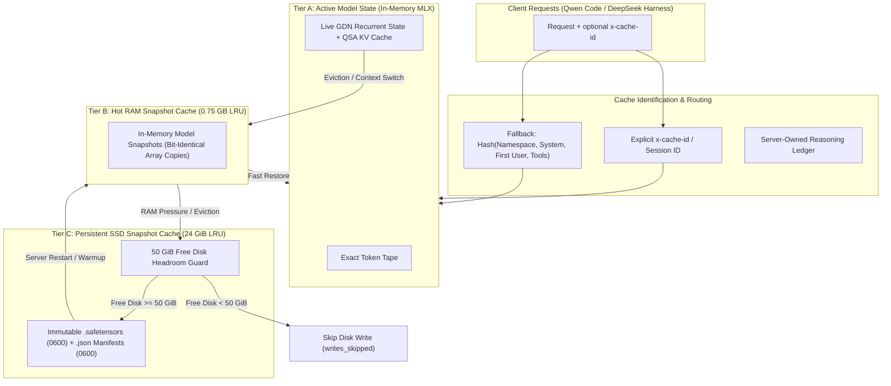

# Veystrix Persistent Cache Architecture (RAM + SSD)

Production launches now use the [shared cache manager](../architecture/unified-cache-nemotron-1m-results.md).
The namespace, quota and tools in the original design below describe the legacy deployment.


## Overview

Veystrix integrates an oMLX-inspired persistent three-tier caching engine tailored for hybrid state models like Qwen3.8-Flash-Next (featuring GatedDeltaNet recurrent layers and Quasi-Static Attention / QSA KV layers).



---

## 1. The Three-Tier Cache Hierarchy

### Tier A: Active Model State
- **Purpose**: Represents the live, actively decoding model state.
- **Components**:
  - GatedDeltaNet (GDN) recurrent state tensors (~113 MB for Flash-Next architecture).
  - QSA KV cache slices (keys, values, index_keys, position IDs).
  - Exact token tape and generation continuation tokens.
- **Invariants**: Active state is never mutated during asynchronous reads or evicted unsafely while in-flight inference is running.

### Tier B: Hot RAM Snapshot Cache
- **Purpose**: Fast in-memory turnaround for session switching, multi-turn branches, and short-term dialogue reuse.
- **Budget**: Default `750 MB` (`0.75 GB`), configurable via `FLAG_RAM_MB`.
- **Policy**: Pure Least-Recently-Used (LRU). When the RAM budget is exceeded, snapshots are preserved by spilling to Tier C.

### Tier C: Persistent SSD Snapshot Cache
- **Purpose**: Long-term disk persistence across server restarts, allowing instantaneous restarts and cross-process session recovery.
- **Location**: Default `~/.flashnext/prefix-cache/` (overridable via `FLAG_CACHE_DIR`).
- **Disk Budget**: Configurable default `24 GiB` (`24,000,000,000` bytes).
- **50 GiB Headroom Safety Floor**: Before any snapshot is written to disk, `shutil.disk_usage` inspects available storage. If free space would drop below `50 GiB`, disk writes are safely aborted and recorded in `stats.writes_skipped`.
- **Format**:
  - Binary tensor weights: `.safetensors` format with zero-copy loading.
  - Manifest metadata: `.json` files detailing token count, SHA-256 tokens hash, parent hash (for delta chains), format version (v3), creation timestamp, and file permissions.

---

## 2. Content Addressing, Delta Chaining, and Eviction

### Content-Addressing
Snapshots are keyed by `sha256(tokens)`. Because KV activations in autoregressive transformers and GDN states depend strictly on exact prior tokens, identical token prefixes guarantee 100% bit-exact state matching.

### Delta Chaining
- To avoid repeatedly writing full 113 MB GDN recurrent checkpoints across multi-turn interactions, snapshots record parent hashes and token boundaries.
- QSA KV layers store only newly appended token slices between turn boundaries.

### Chain-Aware Eviction
- When disk usage approaches the 24 GiB ceiling, the LRU eviction algorithm evicts leaf snapshots first.
- Parents referenced by other child snapshots are preserved until all dependants are safely retired, preventing broken delta chains.

---

## 3. Privacy, Disk Permissions, and Leases

- **File Permissions**: Cache directories are initialized with `0700` (`rwx------`). Snapshot files and manifests are written with `0600` (`rw-------`), ensuring other local users cannot inspect cached prompt or reasoning tokens.
- **Process Ownership**: A PID-bound lockfile (`.owner.json`) manages directory ownership to avoid multi-instance corruption.
- **Explicit CLI Inspection & Cleanup Tool**:
  ```bash
  # Inspect cache contents and statistics
  .venv/bin/python -m veystrix.cache_tools --inspect

  # Clean snapshots older than 7 days, maintaining a 20 GB disk target
  .venv/bin/python -m veystrix.cache_tools --cleanup --target-disk-gb 20 --max-age-days 7
  ```
