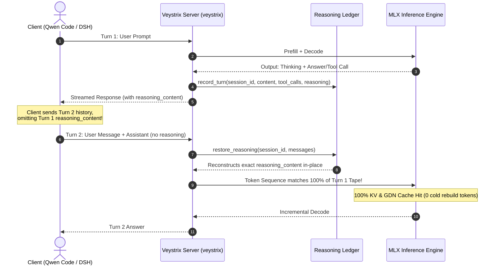

# Veystrix Reasoning & Dual-Harness Compatibility Matrix

## Overview

Veystrix supports fine-grained reasoning effort levels across both Qwen Code and DeepSeek Harness (DSH). Because client tools differ substantially in how they format, transmit, and omit intermediate reasoning chains, Veystrix implements an authoritative **Server-Owned Reasoning Ledger**.

---

## 1. Client Wire-Level Differences

| Client | Endpoint | Reasoning Preservation Behavior | Tool Argument Encoding | Cache ID Header |
| :--- | :--- | :--- | :--- | :--- |
| **Qwen Code 0.27.0** | `/v1/chat/completions` | OLU / Complete omission of `<think>` chains on subsequent assistant turns | JSON objects / stringified JSON | Auto-digest / `X-Veystrix-Session` |
| **DeepSeek Harness (dsh)** | `/v1/chat/completions` & `/v1/responses` | Preserves `reasoning_content` on assistant messages that contain tool calls; omits on pure response turns | JSON string (`"{\"path\":\"...\"}"`) | `x-cache-id`, `X-Session-Id` |

---

## 2. Reasoning Effort Level Mapping

| Configured Tier | Jinja Chat Template Effort | Extra System Instructions Injected | Real Checkpoint Support | Behavior & Recovery |
| :--- | :--- | :--- | :--- | :--- |
| **disabled / off** | `None` / `enable_thinking=false` | None | Verified | No `<think>` block generated; immediate answer tokens |
| **low** | `low` | None (template native) | Verified | Brief reasoning tokens |
| **medium** | `medium` | None (template native) | Verified | Balanced reasoning depth |
| **high** | `medium` | Appended high-effort instructions (`EXTRA_REASONING["high"]`) | Verified | Deep chain-of-thought with rigorous assumption checking |
| **xhigh** | `xhigh` | None (template native) | Verified | Maximum reasoning exploration |
| **max** | `xhigh` | None | Verified (Clamped) | Clamped to `xhigh` with clean telemetry reporting |

---

## 3. Server-Owned Reasoning Ledger Architecture

When clients drop reasoning tokens in subsequent turns, standard inference engines suffer cold cache misses because the Jinja chat template renders divergent prompt token streams.

### Safety & Privacy Guarantees
1. **Namespace Isolation**: Session keys are prefixed with `id:{namespace}:{id}` (e.g. `qwen-code` vs `deepseek-harness`). Session A private reasoning can never be restored into Session B.
2. **Ambiguity Rejection**: If the client alters the visible text or tool calls of an earlier turn, the ledger rejects the match and triggers a safe cold rebuild rather than hallucinating wrong reasoning.
3. **Rollback & Branching Awareness**: If an agent rolls back turns or resumes from an earlier point in the conversation, the ledger automatically trims subsequent turns to match the current tree branch.
