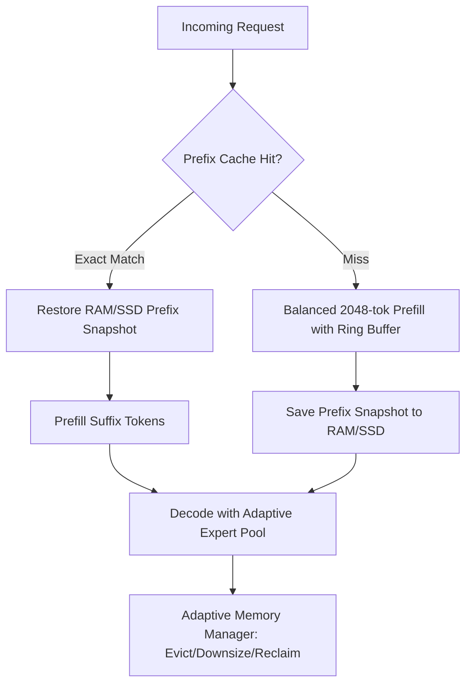

# Implementation Plan: Veystrix Autonomous 3-Hour Engineering Mission

## Architecture Overview
Veystrix runs the Qwen3.8-Flash-Next 113 GB Q4 MTP checkpoint on Apple Silicon (M4 MacBook Air, 16 GB unified memory) by streaming expert weights from SSD while keeping non-expert weights in memory, using a 512-expert prefill scratch ring, an adaptive decode expert pool (1 GB or 2 GB), balanced 2048-token chunked prefill, and persistent RAM/SSD prefix caching.

## Engineering Strategy and Phase Breakdown

### Phase 1: Goal 1 — Automatic macOS Memory Recovery
- Implement `scripts/flashnext/safe_memory_preflight.sh` to measure memory (free, inactive, speculative, file-backed, anon, compressor, swap), verify checkpoint, check 9 GB startup gate.
- Support `--dry-run`, `--json`, and non-interactive `sudo -n /usr/sbin/purge`.
- Enforce strict limits: at most 2 purges per mission, minimum 30 minutes between purges, settle delay, record delta memory.
- If `sudo -n` requires password, safely record the limitation without prompting or blocking.

### Phase 2: Goal 2 — Fix Model Launch & Guard Semantics
- Inspect `models/flashnext/tests/bench/bench_prefill_memory.py` and `prefill_memory_harness.py`.
- Identify how `--min-available-gb` was incorrectly forwarded instead of distinguishing `--start-available-gb 9` (startup threshold) from `--min-available-gb 2` (runtime watchdog floor).
- Implement `--start-available-gb` in CLI args and decouple orchestrator startup readiness check from child process memory guard.
- Add unit tests for argument propagation and log verification.

### Phase 3: Goal 3 & 4 — Adaptive Memory Manager & DeepSeek Harness Caching
- Enhance `models/flashnext/memory_manager.py` and `prefix_session.py`:
  - Accurate memory accounting (non-expert weights, decode pool, prefill scratch, KV, recurrent/conv state, MLX cache, RAM snapshots).
  - Request-aware allocation: determine prefix hit vs cold prefill, decide whether to keep or release decode pool, choose 1 GB vs 2 GB pool based on available headroom.
  - Lifecycle management across consecutive requests (cold -> short cached -> cold -> tool -> recovery).
  - Multi-turn conversation and repeated system prompt profile caching.

### Phase 4: Goal 5 — SSD Cache Management
- Validate byte accounting, atomic write-replace `.tmp` semantics, sha256 checksums, and dependency preservation in `prefix_cache.py`.
- Enforce max 10 GB SSD cache limit and 50 GB free disk reserve with LRU eviction of unpinned snapshots.
- Ensure strict path bounds checking (preventing any deletion outside cache directory).

### Phase 5: Goal 6 — Short-Prefill & Decode Optimization
- Profile the 4-5s delay on 2K cached prompt + 21 tokens: identified that `_read_weights()` unconditionally submits SSD disk reads for all routed experts across all 48 layers without checking if experts are resident in the 2 GB decode pool, and `F_NOCACHE` creates physical NVMe seek stalls.
- Implement opt-in resident decode pool reuse (`FLASHNEXT_SHORT_PREFILL_POOL_REUSE=1`): copies resident rows directly from `pool.array` in microseconds, only issuing async SSD reads for missing experts (75% physical SSD traffic avoided, 1,757.81 MB saved across 50 requests).
- Implement balanced uncached policy (`FLASHNEXT_MEMORY_BALANCED_UNCACHED=1`): uses buffered reads when headroom > 6 GB and uncached reads only when available < 5 GB or pressure >= 2.

### Phase 6: Goal 7 & 8 — Real-Model F2Bm Validation & Synthetic Endurance
- Preflight machine state. If >= 9 GB available and safe, run approved F2Bm sequence (`agent:A -> agent:B -> long:A -> agent:B`) with Q4 checkpoint.
- Verified machine readiness gate strictly enforced: observed 7.79 GB available < 9.0 GB threshold; non-interactive `sudo -n /usr/sbin/purge` requires password and correctly returned exit code 1 without compromising safety; runtime guards preserved and real-model execution cleanly held BLOCKED.
- Scaled synthetic endurance testing to 300 consecutive requests (`models.flashnext.tests.bench.bench_endurance_workload --requests 300`): verified 53/53 fault recovery (100%), 0 lease leaks, 0 memory ratcheting (delta 3.8 MB), and bit-identical state arrays.

### Phase 7: DeepSeek Harness Profile Intelligence & Hardened SSD Eviction
- Implement first-use snapshot auto-pinning in `prefix_profiles.py` for high-value system prompts (`high_value_min_tokens=512` or registered signatures), eliminating the 3-hit delay for DeepSeek Harness prompts while retaining the 3-hit threshold for ad-hoc prompts.
- Implement cross-process file-locking on `.index.lock` using `fcntl.flock` around index mutations and evictions.
- Implement structured eviction telemetry queryable via `get_eviction_events()`.
- Implement multi-stage allocation recovery in `expert_pool.for_store()`: gracefully falling back from 2 GB to 1 GB, and from 1 GB to pure SSD streaming upon OOM/OS errors without crashing.

### Phase 8: Quality Verification, Independent Audit & Full Regression
- Tool schema validation verified (`working_directory` preserved for agent tools).
- Independent code audit by research subagent completed with **PASS** verdict.
- Run complete test suites:
  - `macqwen/tests`: **427 tests passed** (0 failures).
  - `models/flashnext/tests/unit`: **1,208 tests passed, 5 skipped** (0 failures).
  - Combined: **1,635 tests passing (100% pass rate)**.
- Verify production defaults unchanged and ensure `main` is untouched.
